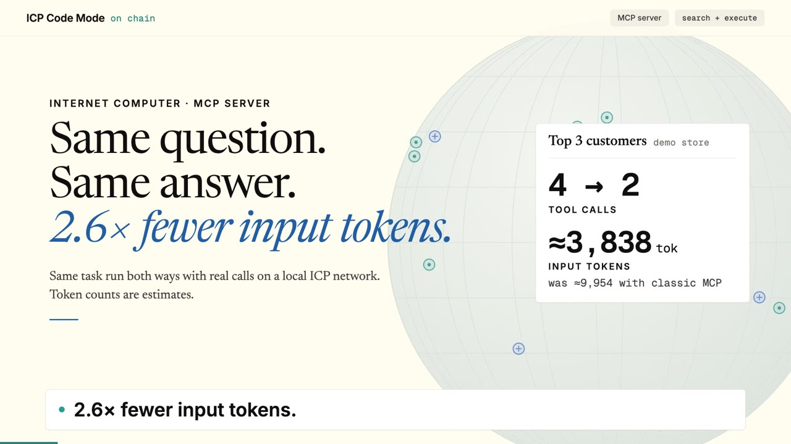

# ICP Code Mode — an MCP server inside a canister

[](video/icp-code-mode-explainer.mp4)

▶ **[Watch the 52-second explainer](video/icp-code-mode-explainer.mp4)** (1080p, with voiceover and captions).
It shows the same task run with classic MCP and with Code Mode, both against a demo store canister.

An Internet Computer canister that speaks the **Model Context Protocol** (2025-03-26,
Streamable HTTP via the ICP HTTP gateway) and follows the search-and-execute pattern
with two tools:

- **`search_icp_canisters`** — read-only discovery. It lists the allowlisted canisters, their
  allowed methods with Candid signatures, and the types those signatures use, filtered by
  keywords. It is answered by the query call, so it is fast and free.
- **`execute_icp_script`** — instead of dozens of granular tools, the LLM sends one short
  script in **JavaScript**, **Python** or **Rhai**.

The script:

- discovers target canisters' Candid interfaces,
- batches inter-canister calls,
- filters and transforms the data inside the Wasm sandbox,
- returns one distilled JSON result.

On-chain policy (allowlist, call cap, instruction budget) is enforced, and every run is audited.

## Benefits

- **Fewer round-trips:** Batch multiple inter-canister calls (`Promise.all` / `asyncio.gather`) inside a single `tools/call` instead of sequential LLM tool turns.
- **Smaller context window:** Filter, join, and aggregate raw Candid responses inside the Wasm sandbox so only the final JSON summary reaches the model.
- **Zero per-canister tool wiring:** `search_icp_canisters` and `icp.candid` discover `.did` interfaces dynamically—no custom MCP server or schema needed per canister.
- **Deny-by-default safety & auditability:** Controllers restrict access per `(Principal, method)`, cap calls/instructions, and inspect an append-only on-chain `StableLog`.
- **No local MCP runtime:** Any HTTP-capable MCP client (Claude, Gemini, etc.) connects directly to the canister URL with a Bearer token.

## Comparison with Cloudflare Code Mode

Cloudflare's Code Mode introduced the pattern of letting an LLM write code against a typed SDK inside a sandbox rather than calling many fine-grained MCP tools. **ICP Code Mode** brings that same search-and-execute pattern natively onto the Internet Computer, with several advantages for ICP workflows:

- **On-chain, consensus-certified execution:** Scripts run inside the canister's deterministic Wasm sandbox (`http_request_update`) and make native inter-canister calls, rather than running in an off-chain isolate talking to external RPCs.
- **Native Candid bridge:** Built-in `.did` parsing and type-directed JSON ⇄ Candid conversion—no off-chain IDL tooling or generated client bindings required.
- **Multi-language runtime:** Supports **JavaScript** (Boa), **Python** (Monty), and **Rhai** in one canister (or per-language feature builds).
- **On-chain policy & immutable audit log:** Allowlists, SHA-256 token hashes, instruction budgets, and `StableLog` audit entries live in canister stable memory and survive upgrades.
- **Zero external infra:** The canister *is* the MCP server via the ICP HTTP gateway—no separate Worker, proxy, or API server to host.

## Quickstart (How to use)

1. **Deploy locally** ([build & deploy details](#deploy-locally-with-icp-cli)):
   ```bash
   icp network start -d && icp deploy
   ```
2. **Create and register a Bearer token** ([token details](#create-a-bearer-token-only-its-sha-256-goes-on-chain)):
   ```bash
   export MCP_TOKEN=$(openssl rand -hex 32)
   icp canister call icp_code_mode add_api_token_hash "(\"$(printf %s "$MCP_TOKEN" | shasum -a 256 | cut -d' ' -f1)\", \"my-laptop\")"
   ```
3. **Allowlist target canisters/methods** ([policy & admin endpoints](#allowlist-what-scripts-may-call-deny-by-default)):
   ```bash
   icp canister call icp_code_mode set_allowlist '(principal "ryjl3-tyaaa-aaaaa-aaaba-cai", vec {"icrc1_balance_of"; "icrc1_symbol"; "icrc1_decimals"; "icrc1_metadata"; "icrc1_total_supply"})'
   ```
4. **Connect your MCP client** ([client config](#mcp-client-config)) or **test with `curl`** ([curl examples](#curl-examples-local)) against `http://icp_code_mode.local.localhost:8010/mcp` (or `https://<canister-id>.icp0.io/mcp` on mainnet).

For SDK signatures, value encoding, and execution limits, see [The `icp` SDK](#the-icp-sdk) and [Guardrails](#guardrails).

```
MCP client ──POST /mcp──▶ HTTP gateway ──▶ http_request (query)
                                             ├─ initialize / tools/list / ping → answered here
                                             ├─ search_icp_canisters → answered here from cached interfaces
                                             └─ execute_icp_script (or search needing a fetch) → upgrade: true
                                  ──▶ http_request_update (update)
                                        LanguageRouter ─▶ Boa | Monty | Rhai   (fresh VM per call)
                                              │ icp.candid / icp.call / icp.principal
                                        HostBridge ─▶ policy::check_call ─▶ candid_bridge (JSON⇄Candid)
                                              └─▶ ic_cdk::call::Call::unbounded_wait ─▶ target canister
                                        audit log (StableLog) ◀─ one entry per run
```

## Layout

| Path | What |
|---|---|
| `src/lib.rs` | Lifecycle (`init`, `post_upgrade`), `http_request` / `http_request_update`, admin endpoints, skip-certification, counting allocator, deterministic `getrandom` backend |
| `src/mcp.rs` | JSON-RPC 2.0 router (`initialize`, `notifications/initialized`, `ping`, `tools/list`, `tools/call`, batches), bearer auth |
| `src/bridge.rs` | `HostBridge` trait (shared by all runtimes) and `IcBridge` (policy → Candid fetch → call → decode) |
| `src/candid_bridge.rs` | `.did` parsing (`candid_parser`) and type-directed `serde_json::Value` ⇄ `IDLValue` conversion |
| `src/demo.html` | Demo UI served at `GET /`, including the Classic MCP vs Code Mode comparison |
| `demo_store/` | Demo target canister: 10 store methods with seed data |
| `scripts/demo-setup.sh` | Allowlists `demo_store` in `icp_code_mode` |
| `video/` | Explainer video: script, HTML composition, Gemini TTS and render pipeline, final MP4 |
| `src/search.rs` | `search_icp_canisters`: allowlist × interface → filtered signatures and referenced type definitions |
| `src/policy.rs` | Stable-memory guardrails: allowlist, limits, SHA-256 token hashes, append-only audit log |
| `src/runtimes/` | `LanguageRouter` + `js.rs` (Boa), `python.rs` (Monty), `rhai_rt.rs` (Rhai) |
| `icp_code_mode.did` | Canister interface. A test checks that it matches `export_candid!` |
| `icp.yaml` | icp-cli project (build steps, local network on port 8010) |
| `shims/web-time`, `vendor/chrono` | `[patch]`es that keep wasm-bindgen imports out of the Wasm (see "Why the patches") |

## Build and test

Requirements:
- Rust 1.100, pinned in `rust-toolchain.toml` (monty 1.6 needs ≥ 1.98)
- the `wasm32-unknown-unknown` target
- [icp-cli](https://cli.internetcomputer.org) ≥ 1.7
- `ic-wasm`

```bash
cargo test
```

```bash
cargo build --target wasm32-unknown-unknown --release --locked
```

Engines are Cargo features (`default = ["js", "python", "rhai"]`). To build a dedicated
per-language worker, for example a Rhai-only one:

```bash
cargo build --target wasm32-unknown-unknown --release --no-default-features --features rhai --target-dir target/rhai
```

To deploy a worker, copy the canister entry in `icp.yaml` under a new name and use that build command.
The all-in-one build is about 12 MB (3.6 MB gzipped). JS + Rhai without Python is about 6 MB.

To regenerate the `.did` after changing endpoints:

```bash
candid-extractor target/wasm32-unknown-unknown/release/icp_code_mode.wasm > icp_code_mode.did
```

## Deploy locally with icp-cli

```bash
icp network start -d
```

```bash
icp deploy
```

The gateway URL is printed on deploy: `http://icp_code_mode.local.localhost:8010/`.
The network uses port 8010 (set in `icp.yaml`) so it can run next to other projects on the default 8000.

### Create a bearer token (only its SHA-256 goes on-chain)

```bash
export MCP_TOKEN=$(openssl rand -hex 32)
```

```bash
icp canister call icp_code_mode add_api_token_hash "(\"$(printf %s "$MCP_TOKEN" | shasum -a 256 | cut -d' ' -f1)\", \"my-laptop\")"
```

### Allowlist what scripts may call (deny by default)

The local network ships an ICP ledger:

```bash
icp canister call icp_code_mode set_allowlist '(principal "ryjl3-tyaaa-aaaaa-aaaba-cai", vec {"icrc1_balance_of"; "icrc1_symbol"; "icrc1_decimals"; "icrc1_metadata"; "icrc1_total_supply"})'
```

Use `vec {"*"}` to allow every method of a canister. The other admin endpoints are controller-only:
- `set_limits(record { max_calls_per_script; max_instructions; call_timeout_seconds; certified_reads })`
  (the last two are optional; see "Options" below)
- `remove_allowlist`
- `revoke_api_token_hash`
- `set_candid_override(principal, opt text)`
- `get_policy`, `get_audit_logs(offset, limit)`, `get_audit_log_len`

## Demo store and side-by-side comparison

`demo_store/` is a second canister: a small shop with 10 methods (7 reads, 3 writes) and
deterministic seed data (12 products, 8 customers, 60 orders). It exposes its interface
through `__get_candid_interface_tmp_hack`. Deploying it and allowlisting its reads plus
`create_order` takes two commands; `cancel_order` and `restock` stay blocked, so the
guardrail is visible:

```bash
icp deploy
```

```bash
scripts/demo-setup.sh
```

The demo page's **Classic MCP vs Code Mode** section runs each task both ways against the
store and checks that both sides return the same answer:
- **Classic MCP:** one tool per store method. Each call is a real tool call, and its full result
  goes through the model.
- **Code Mode:** one search, then one script.

It reports LLM round trips, tool calls, and tool-definition / tool-result / generated / total
input tokens (estimated as characters ÷ 4 over a modelled agent loop), plus measured canister
time. "How the numbers are counted" on the page spells out what is measured and what is
modelled.

Measured on the local network:

| Task | Classic MCP | Code Mode | Total input tokens |
|---|---|---|---|
| Top 3 customers by spend | 4 tool calls, ≈3.2k tok of results | 2 tool calls, ≈0.5k tok | 2.6× fewer |
| What needs restocking? | 13 tool calls | 2 tool calls | 1.2× fewer |
| Tea sales report | 2 tool calls, ≈3.1k tok of results | 2 tool calls, ≈0.5k tok | 1.4× fewer |

Code Mode's cost here is mostly its fixed overhead: two tool definitions plus one search.
Classic MCP grows with every row and call, so the gap widens with real data volumes.

## Explainer video

`video/` builds the explainer from source:
- `script.md` has the script and the tweet copy.
- `composition.html` holds the scenes, styled after the ICP dashboard. A `renderAt(t)` function draws any moment of the video.
- `render.mjs` renders it frame by frame in headless Chrome, then encodes with ffmpeg.
- `tts.mjs` voices each scene with Gemini TTS. Scenes are timed to the real audio.
- `capture-demo.mjs` takes screenshots of the live demo page.

Requirements:
- Chrome, Node ≥ 22 and ffmpeg
- `GEMINI_API_KEY` in the environment, in this project's `.env`, or in `~/.env`

The voice argument is optional (default `Puck`):

```bash
video/build.sh Puck
```

The output goes to `video/out/` (gitignored) and is copied to `video/icp-code-mode-explainer.mp4`.

## Demo page

The canister serves a demo UI at `GET /`:
- local: `http://icp_code_mode.local.localhost:8010/`
- mainnet: `https://<canister-id>.icp0.io/`

Paste the bearer token, then use the buttons:
- **Initialize** and **List tools**
- **Search**, with optional keywords
- **Execute**, with five ready-made scripts: a JS ledger overview, Python balance, Python
  batching with `asyncio.gather`, a Rhai interface read, and a call that policy blocks

Each button sends a real JSON-RPC request to `POST /mcp` and shows the result, the console
output and the raw request/response pair. The page contains no secrets. The token stays in
your browser's localStorage and is sent only as the `Authorization` header.
The page is `src/demo.html`, compiled into the Wasm with `include_str!`.

## curl examples (local)

```bash
export MCP=http://icp_code_mode.local.localhost:8010/mcp
```

**initialize** (answered by the query call, no consensus round):

```bash
curl -s $MCP -H "Authorization: Bearer $MCP_TOKEN" -H 'Content-Type: application/json' -H 'Accept: application/json, text/event-stream' -d '{"jsonrpc":"2.0","id":1,"method":"initialize","params":{"protocolVersion":"2025-03-26","capabilities":{},"clientInfo":{"name":"curl","version":"1"}}}'
```

```json
{"id":1,"jsonrpc":"2.0","result":{"capabilities":{"tools":{}},"instructions":"…","protocolVersion":"2025-03-26","serverInfo":{"name":"icp-code-mode","version":"0.1.0"}}}
```

**notifications/initialized** returns `202` with an empty body:

```bash
curl -s -o /dev/null -w '%{http_code}\n' $MCP -H "Authorization: Bearer $MCP_TOKEN" -H 'Content-Type: application/json' -d '{"jsonrpc":"2.0","method":"notifications/initialized"}'
```

**tools/list**:

```bash
curl -s $MCP -H "Authorization: Bearer $MCP_TOKEN" -H 'Content-Type: application/json' -d '{"jsonrpc":"2.0","id":2,"method":"tools/list"}'
```

**tools/call, search.** This is answered by the query call once the target's interface is
cached; the first search after a deploy goes through an update call to fetch it:

```bash
curl -s $MCP -H "Authorization: Bearer $MCP_TOKEN" -H 'Content-Type: application/json' -d '{"jsonrpc":"2.0","id":7,"method":"tools/call","params":{"name":"search_icp_canisters","arguments":{"query":"balance"}}}'
```

```json
{"id":7,"jsonrpc":"2.0","result":{"content":[{"type":"text","text":"{\"canisters\":[{\"allowed_methods\":[\"icrc1_balance_of\",\"icrc1_symbol\",\"icrc1_decimals\",\"icrc1_metadata\",\"icrc1_total_supply\"],\"canister_id\":\"ryjl3-tyaaa-aaaaa-aaaba-cai\",\"methods\":[{\"name\":\"icrc1_balance_of\",\"signature\":\"(Account) -> (Icrc1Tokens) query\"}],\"types\":{\"Account\":\"record { owner : principal; subaccount : opt SubAccount }\",\"Icrc1Tokens\":\"nat\",\"SubAccount\":\"blob\"}}]}"}],"isError":false}}
```

Arguments are optional:
- `query`: space-separated keywords, all of which must appear in a method's name or signature.
- `canister_id`: restrict the search to one canister.

With no arguments, it lists everything that's allowed, up to 40 methods.

**tools/call, JavaScript.** The gateway upgrades the request to an update call. The `Promise.all` sends four calls concurrently:

```bash
curl -s $MCP -H "Authorization: Bearer $MCP_TOKEN" -H 'Content-Type: application/json' -d @- <<'EOF'
{"jsonrpc":"2.0","id":3,"method":"tools/call","params":{"name":"execute_icp_script","arguments":{"language":"javascript","code":"const L = 'ryjl3-tyaaa-aaaaa-aaaba-cai';\nconst did = await icp.candid(L);\nconst [sym, dec, supply, bal] = await Promise.all([\n  icp.call(L, 'icrc1_symbol', null), icp.call(L, 'icrc1_decimals', null),\n  icp.call(L, 'icrc1_total_supply', null),\n  icp.call(L, 'icrc1_balance_of', {owner: icp.principal(), subaccount: null})]);\nconsole.log('did bytes', did.length);\nreturn {sym, dec, supply, bal, methods: (did.match(/icrc1_\\w+/g) || []).length};"}}}
EOF
```

```json
{"id":3,"jsonrpc":"2.0","result":{"content":[{"type":"text","text":"{\"bal\":0,\"dec\":8,\"methods\":14,\"supply\":\"299999999995070000\",\"sym\":\"ICP\"}"},{"type":"text","text":"[console output]\ndid bytes 17368"}],"isError":false}}
```

**tools/call, Python.** `icp.call` looks synchronous. `icp.call_async` together with `asyncio.gather` batches calls:

```bash
curl -s $MCP -H "Authorization: Bearer $MCP_TOKEN" -H 'Content-Type: application/json' -d @- <<'EOF'
{"jsonrpc":"2.0","id":4,"method":"tools/call","params":{"name":"execute_icp_script","arguments":{"language":"python","code":"import asyncio\nL = 'ryjl3-tyaaa-aaaaa-aaaba-cai'\nsym, dec = await asyncio.gather(icp.call_async(L, 'icrc1_symbol'), icp.call_async(L, 'icrc1_decimals'))\nmeta = icp.call(L, 'icrc1_metadata')\nprint('metadata entries:', len(meta))\n{'sym': sym, 'dec': dec, 'keys': [m[0] for m in meta]}"}}}
EOF
```

```json
{"id":4,"jsonrpc":"2.0","result":{"content":[{"type":"text","text":"{\"dec\":8,\"keys\":[\"icrc1:decimals\",\"icrc1:name\",\"icrc1:symbol\",\"icrc1:fee\"],\"sym\":\"ICP\"}"},{"type":"text","text":"[console output]\nmetadata entries: 4"}],"isError":false}}
```

**tools/call, Rhai:**

```bash
curl -s $MCP -H "Authorization: Bearer $MCP_TOKEN" -H 'Content-Type: application/json' -d '{"jsonrpc":"2.0","id":5,"method":"tools/call","params":{"name":"execute_icp_script","arguments":{"language":"rhai","code":"let L = \"ryjl3-tyaaa-aaaaa-aaaba-cai\"; #{sym: icp::call_canister(L, \"icrc1_symbol\"), supply: icp::call_canister(L, \"icrc1_total_supply\")}"}}}'
```

A call blocked by policy comes back as a tool error (`isError: true`). No message is sent, and the violation is audited:

```bash
curl -s $MCP -H "Authorization: Bearer $MCP_TOKEN" -H 'Content-Type: application/json' -d '{"jsonrpc":"2.0","id":6,"method":"tools/call","params":{"name":"execute_icp_script","arguments":{"code":"return await icp.call(\"ryjl3-tyaaa-aaaaa-aaaba-cai\", \"icrc1_transfer\", {})"}}}'
```

```bash
icp canister call icp_code_mode get_audit_logs '(0, 5)'
```

On mainnet, use `https://<canister-id>.icp0.io/mcp`.

### MCP client config

```json
{ "mcpServers": { "icp": { "type": "http", "url": "http://icp_code_mode.local.localhost:8010/mcp",
  "headers": { "Authorization": "Bearer <token>" } } } }
```

## The `icp` SDK

| | JavaScript | Python | Rhai |
|---|---|---|---|
| Interface | `await icp.candid(id)` | `icp.candid(id)` | `icp::candid(id)` |
| Call | `await icp.call(id, m, args)` | `icp.call(id, m, args)` / `await icp.call_async(...)` | `icp::call_canister(id, m, args)` |
| Own principal | `icp.principal()` | `icp.principal()` | `icp::principal()` |
| Output | `console.log`, `print` | `print` | `print`, `debug` |
| Result | `return value` | last expression | last expression |
| Batching | `Promise.all` | `asyncio.gather` | sequential |

How `args` map to the method's arguments:
- `null`: zero arguments.
- An array: positional arguments.
- Anything else: the single argument, for one-argument methods.

How values are encoded:
- Records are objects.
- Variants are `{"Tag": value}`; for a null payload, `"Tag"` alone also works.
- Opt is a value or `null`.
- Principals are text.
- Blobs are byte arrays, or a hex string on input.
- nat/int come back as numbers when JS-safe (±2⁵³) and as decimal strings otherwise. Strings are accepted on input.

## Guardrails

| Guardrail | Value |
|---|---|
| Allowlist | `Principal → ["method" \| "*"]`, deny by default. Checked before any message is sent, including the interface fetch |
| Calls per script | 25 (`set_limits`). Counts `icp.call` and every interface fetch that misses the cache. Reserved before the await, so concurrent batches count |
| Instruction budget | 20B per script, measured from the script's own start. Checked before each host request, between JS rounds, and on every Rhai operation; Python has its own 10B VM budget |
| Requests | At most 50 messages per JSON-RPC batch. One `execute_icp_script` and five searches per HTTP request (further ones get `-32600`). At most 8 scripts run at once across all requests; more get a "busy" error. JS: at most 64 concurrent requests per round and 64 rounds. Rhai: at most 64 requests |
| Values | Any value leaving a script (result, call arguments, printed values) is limited to 128 levels, 200k elements and 4 MiB of text, in all three languages |
| JS (Boa) | 1M loop iterations, recursion 256, 100k promise jobs. `Math.random`, `eval`/`Function`, `Atomics`, `SharedArrayBuffer` and `WeakRef` removed. Fixed clock = block time, UTC. `JSON.stringify` is held to the value limits too, replacer included |
| Python (Monty) | Recursion 200, 64 MiB memory, 256 suspensions. The VM stops when the policy's instruction budget is spent. Fixed `datetime`, zero sleep, seeded `random`, no OS access |
| Rhai | 1M operations per run, 32 call levels, size limits on strings/arrays/maps. `eval` and modules disabled |
| Output | Script source ≤ 100 KiB. Captured logs ≤ 64 KiB, enforced while running. Result ≤ 1 MB of *escaped* JSON. Any reply that would exceed 1.9 MB, whatever it contains, is replaced by a small error, so replying can never trap |
| Audit | Append-only `StableLog`: time, token-hash prefix, language, script SHA-256, canisters, methods, calls, instructions, status, violations (≤ 16, each ≤ 512 B), error (≤ 4 KiB). One entry is written before every outbound message, plus a final entry per run |
| Unpaid-call filter | `inspect_message` rejects update calls that carry no registered token (or, for admin methods, don't come from a controller) before the canister is charged for them |
| Stack | 8 MiB wasm stack (`.cargo/config.toml`), up from Rust's 1 MiB default |

Policy, tokens and the audit log live in `ic-stable-structures`, so they survive upgrades
without `pre_upgrade` code. `post_upgrade` accepts the same optional `InitArgs` as `init`.

**The audit log is written ahead of every outbound message.** Before a script's first
message the canister appends a `Started` entry, and before each later one a `Call` entry. Each
names the target and method (`methods`), and IC state commits when the message is sent. So
if the script traps afterwards, which rolls back its final entry, the log still shows every
call that went out. The final `Ok` / `Error` / `PolicyViolation` entry lists all of them.

All entries of one run carry the same `run_id` (the `Started` entry's id).

A run whose entries are only `Started`/`Call` has no final entry yet. That is not proof of a
trap. It means one of two things:

- **Pending:** the run is still waiting on a reply. `get_policy` lists these runs in
  `pending_run_ids`, next to `active_runs`.
- **Ended without a final entry:** the canister trapped after the messages went out, which
  rolled back the final entry.

The pending list is kept in memory and is empty after an upgrade, so for older runs treat a
missing final entry as "pending or unknown". The script hash can't
link entries: the same code can run several times, and runs interleave across awaits. A run
that never reaches the network writes a single entry whose `run_id` is its own id.

**Options** (both off by default, set with `set_limits`):

- `call_timeout_seconds`: by default calls wait for a guaranteed reply, so an allowlisted
  canister that never answers can keep this canister from stopping and upgrading. With a
  timeout (the IC caps it at 300 s) that can't happen, but a timed-out call may still have
  executed on the target; the error says so.
- `certified_reads`: by default `initialize`, `tools/list` and cached searches are answered by
  query calls. Those are fast and free but not certified, so a single malicious node could
  alter them (the allowlist is still enforced on-chain when a script runs). With
  `certified_reads = opt true` every request goes through an update call (about 0.2 s locally,
  1-2 s on mainnet) and the demo page, which is uncertified HTML that asks for the token, is
  switched off. Read the audit log with an update call for the same reason.

Fetched interfaces are cached for one hour, then fetched again, so a target's interface
change is picked up without upgrading this canister. A failed fetch is remembered for five
minutes, so searches and scripts don't repeat the same calls to a target that exposes no
interface. Interfaces over 512 KiB are refused.

Canister ids are canonicalised (`RYJL3-…` and `ryjl3-…` are the same principal) before the
allowlist check, the interface cache and the override lookup.

## Known limitations

- **JavaScript has no memory cap.** Python is limited to 64 MiB and Rhai by its size
  limits, but Boa offers no memory limit, so a script that hoards memory ends in a trap
  (a 503 for the client). The cap of 8 concurrent scripts limits how far this can spread.
- **One built-in call can still hit the IC's 40B-instruction trap.** Boa cannot be
  interrupted inside a single native operation, such as `new Array(2e8).fill(0)`. Every other
  path stops with a clean error. If this happens before any outbound message, nothing changed,
  nothing is logged, and the client gets a 503 with no result. If it happens after one, the
  `Started`/`Call` entries for every message already sent remain.
- **Bearer tokens are visible to the subnet's node operators and the HTTP gateway**, because
  request contents are replicated to the nodes that run the canister. That is how HTTP
  requests work on ICP. Treat tokens as revocable credentials: one per client, rotated, and
  revoked with `revoke_api_token_hash` when in doubt.
- **All tokens act as one on-chain identity:** calls go out as this canister's principal.
  Tokens are told apart only in the audit log.
- **Rhai replays from the top** for each host request. That costs O(requests²) operations,
  bounded by the 64-request cap and the instruction budget.
- **`opt opt T`:** `?null` and `null` both decode to JSON `null`, and you can't send `?null`.
- **The interface cache lives on the heap**, so it is also re-fetched after an upgrade.
  `canister_metadata` is tried first, but the local pocket-ic replica does not implement it
  yet, so the code falls back to `__get_candid_interface_tmp_hack`.
- **Adding the `Started` and `Call` audit statuses were Candid-breaking changes** for
  `get_audit_logs` clients compiled against an older `.did`. Upgrading needed `icp deploy --yes`.

## Where this differs from the original spec, and why

- **icp-cli instead of dfx.** `icp.yaml` uses explicit script build steps instead of the
  `@dfinity/rust` recipe, so Cargo features can be passed.
- **getrandom uses the `custom` backend, not `wasm_js`.** `wasm_js` links wasm-bindgen
  imports, and the IC refuses to install a module that imports anything outside `ic0`.
  The custom backend is a fixed deterministic stream: every replica must compute the same
  state, and it is only used for hash seeding.
- **Why the patches.** monty-types reads `web_time::Instant` on every execution window, and
  chrono's default `wasmbind` feature pulls in `js_sys::Date`. Both add wasm-bindgen imports.
  - `shims/web-time` backs `Instant` with the IC instruction counter. This also turns Monty's
    duration limits into deterministic instruction budgets.
  - `vendor/chrono` is chrono 0.4.45 with `wasmbind` removed from its default features.
  - The release Wasm imports only `ic0.*` (`wasm-objdump -x -j Import`).
- **In Rhai, the call function is `icp::call_canister`**, because `call` is a reserved Rhai keyword.
  Rhai natives are synchronous, so the runtime uses deterministic replay. When a script needs
  an answer it does not have, the run is stopped (uncatchably) and the call is made. The answer
  is cached, and the script re-runs from the top. Cost grows quadratically with the number of
  calls, bounded by the call cap.
- **Interface discovery tries three sources, in order:**
  1. the management canister's `canister_metadata` (the public `candid:service` section; not available on every replica yet),
  2. the target's `__get_candid_interface_tmp_hack`,
  3. an admin-supplied `set_candid_override`.
- **Skip-certification.** Query responses (`initialize`, `tools/list`) carry skip-certification
  headers, so they work on the certified gateway domain, not just `raw`. Script results always
  come from the update call, which consensus certifies.
